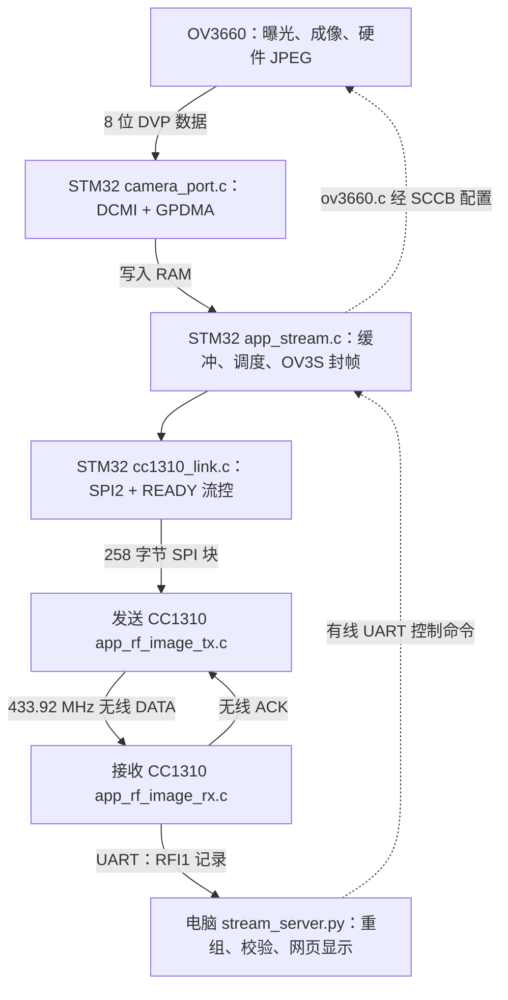

**下位机软件架构与文件职责梳理**

核对日期：2026-10-29。依据当前 `sofeware_V2` 源码、两个 Makefile 和项目内验证记录；本次是静态代码梳理，没有重新连接硬件测试，也没有改动固件。

**1. 先确定阅读范围和系统边界**

项目根目录有 `sofeware_V1`、`sofeware_V2 能够跑完摄像头链路`、`sofeware_V2` 三套相关目录。完整的无线图像收发应用、最新 SPI 桥接、协议和性能记录集中在 [sofeware_V2](/G:/material/cam_hardware/sofeware_V2)，因此以下以它为主。其他目录保留了较早阶段的代码，不应把不同目录同名文件的行为混为一谈。

当前完整系统有三个分别编译、分别烧录的 MCU 程序：

| 运行位置 | 应用选择 | 程序入口 | 核心职责 |
|---|---|---|---|
| 摄像头板 STM32U575 | `APP=stream TRANSPORT=dual` | [app_stream.c](/G:/material/cam_hardware/sofeware_V2/Core/Src/app_stream.c:690) | 配摄像头、采集、缓存、封图像帧、经 SPI 送出；可选串口镜像 |
| 摄像头板 CC1310 | `APP=rf_image_tx BAND=433` | [app_rf_image_tx.c](/G:/material/cam_hardware/sofeware_V2/cc1310/Core/Src/app_rf_image_tx.c:98) | 收 SPI 块、拼无线分片、发射、等待 ACK、重试 |
| 电脑侧 CC1310 | `APP=rf_image_rx BAND=433` | [app_rf_image_rx.c](/G:/material/cam_hardware/sofeware_V2/cc1310/Core/Src/app_rf_image_rx.c:21) | 收无线包、检查顺序与重复、排队输出 UART、回复 ACK |

OV3660 由 STM32 写寄存器配置；本工程没有为 OV3660 编写一套单独烧录的 MCU 应用。电脑侧还需要第二颗 CC1310 接收无线信号，再通过 USB 转串口连接电脑。

三个 MCU 应用都是裸机程序：初始化后进入循环，配合中断与外设工作。没有发现主链路使用 FreeRTOS/TI-RTOS 任务调度。目录中多个 `app_*.c` 是不同固件入口，Makefile 每次选择一个，不是多个同时运行的任务。



这里要区分两种方向：图像已经走无线；网页控制摄像头的 R/M/Q/F 等命令仍经电脑到 STM32 的有线串口，尚未实现“接收 CC1310 → 无线 → 发送 CC1310 → STM32”的远程控制通道。无线 ACK 是传输确认，不是摄像头控制命令。

**2. 软件分层：每层解决什么问题**

| 层次 | STM32 侧 | CC1310 侧 |
|---|---|---|
| 应用调度 | `app_stream.c` 决定抓什么、何时发、处理什么命令 | TX/RX 应用决定分片发送、重试、接收和 UART 转发 |
| 图像/通信协议 | `send_frame()` 生成 OV3S 图像帧；`cc1310_link.c` 切 SPI 块 | `rf_image_protocol.c/.h` 编解码无线头、管理接收顺序与去重 |
| 设备驱动与板级适配 | `ov3660.c` 管传感器寄存器；`camera_port.c` 管 MCU 摄像头接口；`bsp.c` 管公共资源 | `rf_prop.c` 管 RF Core；`rf_image_io.h` 管 UART、电源域和日志 |
| 芯片基础库 | STM32 HAL、CMSIS、可选 ST USB Device Library | TI cc13xxware driverlib、寄存器定义、RF 补丁 |
| 启动/构建 | 启动汇编、系统初始化、链接脚本、Makefile | 启动 C 文件、CCFG、链接脚本、Makefile |

这是一种已有分层、但应用逻辑仍较集中的架构：STM32 的缓存调度、帧协议、命令解析和性能日志都在 `app_stream.c`；CC1310 TX 的 SPI 接收和可靠发送都在一个应用文件中。

**3. STM32 主链路文件逐个说明**

| 文件 | 作用与边界 |
|---|---|
| [Core/Src/app_stream.c](/G:/material/cam_hardware/sofeware_V2/Core/Src/app_stream.c) | 连续图传总入口。负责初始化顺序、启动极性探测、图像池、单/双缓冲、格式/分辨率切换、帧率限制、命令解析、封帧、选择 USB/UART/SPI 通道和统计。阅读整个系统从这里开始。 |
| [Core/Src/camera_port.c](/G:/material/cam_hardware/sofeware_V2/Core/Src/camera_port.c) | 摄像头在 STM32 上的适配层：LDO、RESET/PWDN、XCLK、I2C3/SCCB、GPIO 自检、DCMI、GPDMA、抓帧完成和错误回调。它拿到图像数据，不负责无线分包。 |
| [Core/Inc/camera_port.h](/G:/material/cam_hardware/sofeware_V2/Core/Inc/camera_port.h) | 当前自研板摄像头引脚定义、诊断类型与 `CAM_*` API；改摄像头硬件接线时先核对这里和对应实现。 |
| [Drivers/BSP/OV3660/ov3660.c](/G:/material/cam_hardware/sofeware_V2/Drivers/BSP/OV3660/ov3660.c) | 传感器驱动：读 ID、复位、写寄存器表、设置 RGB565/YUV422/灰度/JPEG、分辨率、PLL、量化参数、彩条、镜像翻转。通过回调读写 SCCB，不直接依赖 STM32 I2C 句柄。 |
| [Drivers/BSP/OV3660/ov3660.h](/G:/material/cam_hardware/sofeware_V2/Drivers/BSP/OV3660/ov3660.h) | 传感器地址/ID、像素格式与分辨率枚举、状态码、`ov3660_io_t` 回调结构和对外接口。 |
| [Drivers/BSP/OV3660/ov3660_regs.h](/G:/material/cam_hardware/sofeware_V2/Drivers/BSP/OV3660/ov3660_regs.h) | 默认初始化和各输出格式的寄存器表，供 `ov3660.c` 按表写入；属于传感器配置数据。 |
| [Core/Src/cc1310_link.c](/G:/material/cam_hardware/sofeware_V2/Core/Src/cc1310_link.c) | SPI2 主机链路：引脚与 IOSwap、模式 1、可调 SPI 速度、GPIO 片选、READY 等待、258 字节封包、超时和调试计数。当前使用阻塞 `HAL_SPI_TransmitReceive`，没有 SPI DMA。 |
| [Core/Inc/cc1310_link.h](/G:/material/cam_hardware/sofeware_V2/Core/Inc/cc1310_link.h) | 暴露 `CC_LinkInit()`、`CC_LinkWrite()`、`CC_LinkSetSpeed()` 三个接口。 |
| [Core/Src/bsp.c](/G:/material/cam_hardware/sofeware_V2/Core/Src/bsp.c) | 公共底座：`BSP_Init()`、160 MHz 系统时钟、供电设置、VDDIO2、ICACHE、USART1、LED、二进制 UART 写入、printf 字符输出和致命错误处理。 |
| [Core/Inc/bsp.h](/G:/material/cam_hardware/sofeware_V2/Core/Inc/bsp.h) | 公共板级资源定义：USART1 PA9/PA10、LED6 PD2、白光 LED PG14、低电平点亮规则、波特率和函数声明。 |

传感器控制的实际调用链是：

```text
app_stream.c 调用 ov3660_set_framesize()/ov3660_set_quality()
    → ov3660.c 决定要写哪些寄存器
    → ov3660_io_t.write_reg/read_reg 回调
    → camera_port.c 的 sccb_write()/sccb_read()
    → HAL_I2C_Mem_Write()/HAL_I2C_Mem_Read()
    → I2C3 → OV3660 SCCB
```

图像内容不通过 I2C 搬运，而通过 OV3660 的并行 DVP → STM32 DCMI → GPDMA → RAM。

STM32 当前的“图像处理”主要是配置摄像头、确定 JPEG 长度、管理缓冲、计算字节和、封装传输协议。主链路中没有看到目标识别、图像分割、滤波或 STM32 软件 JPEG 编码模块。JPEG 压缩在 OV3660 内部完成；原始像素模式的网页 JPEG 编码在电脑端完成。

**4. 一帧图像在 STM32 上如何运行**

启动顺序见 [main()](/G:/material/cam_hardware/sofeware_V2/Core/Src/app_stream.c:690)：

1. `BSP_Init()` 建立时钟、电源和调试串口；初始化状态资源及 UART 命令接收。
2. `stream_link_init()` 根据编译选项初始化 USB 或 CC1310 SPI 链路。
3. `CAM_PowerRailsOn()`、`CAM_SccbInit()`、`CAM_BindSensorIo()`、`CAM_XclkStart()`、`CAM_PowerUp()` 建立摄像头电源、时钟和控制总线。
4. `ov3660_read_id()` 检查传感器；`ov3660_reset()` 加载寄存器表；配置初始原始像素格式/分辨率，等待自动曝光/白平衡收敛。
5. `pick_polarity()` 试四组同步/采样极性并抓帧确认。dual 构建再切入硬件 JPEG。
6. 进入循环：完成当前采集 → 在帧间处理配置命令 → 条件允许则先启动下一缓冲采集 → 封装并发送当前帧。

关键函数定位：

| 函数 | 解决的问题 |
|---|---|
| [send_frame()](/G:/material/cam_hardware/sofeware_V2/Core/Src/app_stream.c:258) | 构造 14 字节 OV3S 头、计算图像 payload 的 sum32、发送头/图像/尾；dual 模式可先发送 UART 镜像。 |
| [pick_polarity()](/G:/material/cam_hardware/sofeware_V2/Core/Src/app_stream.c:328) | 用实际抓帧选择可工作的 DCMI 极性，保存结果供后续重配置复用。 |
| [apply_framesize()](/G:/material/cam_hardware/sofeware_V2/Core/Src/app_stream.c:373) | 停止/反初始化 DCMI，切传感器格式与尺寸，确定缓存布局，重新配置 DCMI/GPDMA。 |
| [handle_commands()](/G:/material/cam_hardware/sofeware_V2/Core/Src/app_stream.c:475) | 从 UART/USB 接收缓冲读取 ASCII 行，修改运行参数。 |
| [CAM_CaptureJpegStart()](/G:/material/cam_hardware/sofeware_V2/Core/Src/camera_port.c:789) | 清缓冲中旧结束标记，清状态，启动快照 DMA，并显式使能 JPEG 的 FRAME 等中断。 |
| [CAM_CaptureJpegWait()](/G:/material/cam_hardware/sofeware_V2/Core/Src/camera_port.c:815) | 等待帧结束/同步事件/错误/超时，停止采集，检查 SOI `FFD8` 并寻找 EOI `FFD9` 得出有效长度。 |
| [CAM_CaptureStart()/Wait()](/G:/material/cam_hardware/sofeware_V2/Core/Src/camera_port.c:874) | 定长原始像素模式的启动/完成接口。Start 启动硬件后返回，Wait 在主循环等待完成。 |

缓冲策略见 `app_stream.c` 的固定 `s_pool`：

| 模式 | 缓冲布局 | 运行方式 |
|---|---|---|
| JPEG，VGA 及以下，P1 | 两块 307200 字节，共 614400 字节 | DMA 采下一帧，CPU 发送上一帧 |
| JPEG，超过 VGA，或 P0 | 一块 614400 字节 | 抓完再发 |
| RGB565/灰度，帧字节数 ≤ 307200 | 双缓冲 | 抓发重叠 |
| RGB565/灰度，307200 < 帧字节数 ≤ 614400 | 单缓冲 | 抓完再发 |
| 原始像素需要 > 614400 字节 | 拒绝该配置 | 不超出池容量 |

RGB565 当前最多放下一帧 VGA；更大尺寸改走灰度后仍受容量限制，例如 SVGA 灰度可容纳，XGA 灰度超出池容量。JPEG 的分辨率表支持到 QXGA，但实际压缩结果仍必须能装进所选缓冲，不能理解成任意画面都没有容量上限。

双缓冲是“两块完整图像存储空间”；GPDMA 的两个链表节点是“将一次大内存搬运拆成块”的机制，两者层次不同。`CAM_DcmiInitEx()` 按容量是否大于 65535 字节选择单节点非循环或双节点循环，HAL 的 DMA 长度参数使用 32 位字数，因此传入字节数除以 4。

**5. STM32 与 CC1310 的 SPI 接口**

现有图传使用 [cc1310_link.c](/G:/material/cam_hardware/sofeware_V2/Core/Src/cc1310_link.c:14) 的 SPI2，与旧 `app_spitx.c` 的 SPI1 测试不同。

| STM32 引脚 | CC1310 引脚 | 职责 |
|---|---|---|
| PB13 | DIO9 | SPI2 时钟 |
| PB14 | DIO7 | STM32 发送数据；通过 IOSwap 得到此方向 |
| PB15 | DIO6 | STM32 接收 CC1310 返回的调试签名字节 |
| PE9 | DIO5 | GPIO 控制 CS，低有效 |
| PD15 | DIO8 | CC1310 READY：高表示可以接下一块 |
| PD14 | RESET_N | 复位线，STM32 使用开漏释放 |

SPI 默认模式 1、2.5 MHz、8 位、MSB first；运行命令 S0/S1/S2 可选择 625 kHz/1.25 MHz/2.5 MHz。

每次 CS 拉低发送固定 258 字节：`uint16_le 有效长度 + 256 字节数据区`，实际有效数据为 1～256 字节，不足部分补零。

握手过程：STM32 等 READY 高 → 拉低 CS → 发送整块 → 抬高 CS → 等 READY 低，确认 CC1310 已收下这一块。CC1310 保持 READY 低处理该块及其无线发送，处理结束才重新拉高。这样无线较慢时会反向限制 SPI 的供数速度。

READY 低只说明 SPI 块已接收，不表示图像已在电脑显示。MISO 的 `CC13` 签名也只是链路诊断，不是无线 ACK。

还有一个隐含接口约定：`send_frame()` 先单独写 14 字节头，TX 固件用 `n == 14 && magic == OV3S` 识别新帧。如果以后把头和 payload 合并成一个 SPI 块，必须同步修改 CC1310 的起帧识别逻辑。

**6. CC1310 无线主链路文件逐个说明**

| 文件 | 作用与边界 |
|---|---|
| [Core/Src/app_rf_image_tx.c](/G:/material/cam_hardware/sofeware_V2/cc1310/Core/Src/app_rf_image_tx.c) | 发送板主程序。SSI0 收固定 SPI 块，识别 OV3S 头，跟踪整帧长度，跨 SPI 块积攒最多 224 字节有效数据，发送无线 DATA 并等待匹配 ACK；失败后放弃该帧无线发送但继续接收/消化剩余 SPI 字节。UART 仅输出状态。 |
| [Core/Src/app_rf_image_rx.c](/G:/material/cam_hardware/sofeware_V2/cc1310/Core/Src/app_rf_image_rx.c) | 接收板主程序。接收无线包、协议校验和去重、检查 UART 队列容量、输出 RFI1 记录、发送 ACK。它不保存或解码完整 JPEG。 |
| [Core/Src/rf_image_protocol.c](/G:/material/cam_hardware/sofeware_V2/cc1310/Core/Src/rf_image_protocol.c) | 与硬件无关的无线协议逻辑：小端整数、字节和、RFI_Encode/RFI_Decode、RFI_Accept 接收状态推进及重复识别。 |
| [Core/Inc/rf_image_protocol.h](/G:/material/cam_hardware/sofeware_V2/cc1310/Core/Inc/rf_image_protocol.h) | 20 字节头、224 字节最大数据、DATA/ACK 类型、START/END 标记、包结构和接收状态结构定义。 |
| [Core/Src/rf_prop.c](/G:/material/cam_hardware/sofeware_V2/cc1310/Core/Src/rf_prop.c) | 直接驱动 RF Core：电源域、晶振、RF 补丁、射频配置、合成器、RAT、阻塞发包/收包、超时及状态码。通过 RF doorbell 提交命令，未使用 TI-RTOS RF 驱动。 |
| [Core/Inc/rf_prop.h](/G:/material/cam_hardware/sofeware_V2/cc1310/Core/Inc/rf_prop.h) | 对上层提供 RFP_Init/Send/Receive、错误枚举、最近状态查询等接口。 |
| [Core/Inc/rf_prop_band.h](/G:/material/cam_hardware/sofeware_V2/cc1310/Core/Inc/rf_prop_band.h) | 无线物理参数：频段、频率、速率、调制、接收带宽、同步字、功率值、寄存器覆盖表。433 MHz 分支提供 50/500 kbps；图传构建默认选 500。 |
| [Core/Inc/rf_image_io.h](/G:/material/cam_hardware/sofeware_V2/cc1310/Core/Inc/rf_image_io.h) | 不只是声明，内含共用实现：电源域/UART 初始化、发送、轻量日志格式化、RF 初始化包装。RX 定义 RF_IMAGE_UART_ASYNC 后启用 8192 字节环形队列和 UART0 TX 中断；TX 使用阻塞状态输出。 |

发送端核心流程：

```text
spi_arm()：配置 SSI0、清 FIFO、准备签名、拉高 READY
    → 收满 258 字节，拉低 READY
    → 检查块长度与溢出
    → process()：识别新帧、累计输入、尽量凑满 224 字节
    → send_fragment()：RFI_Encode → RFP_Send → RFP_Receive 等 ACK
    → 当前 SPI 块处理完，重新 spi_arm()
```

无线采用逐包停等：每个分片最多尝试 3 次（首次发送加最多 2 次重试），每次 ACK 接收等待参数为 65 ms。ACK 必须匹配 session、frame、offset、length 和 flags。一次分片最终失败后，TX 将该图像记为 dropped，停止发送其后续无线分片，继续消化该帧 SPI 输入，下一张图像重新开始。

接收端先复制接收状态试算 `RFI_Accept()`；新数据只有在 UART 队列有足够空间时才提交状态、完整入队，然后 ACK。队列不足则保留旧状态、不 ACK，让发送端重试。重复包返回 2，仅重新 ACK、不重复输出 UART；不合顺序的数据返回 0。

因此 CC1310 的 ACK 表示接收固件接受了分片、并把新数据放入串口输出队列，不表示电脑应用已收到或已经显示。此链路没有 PC 到发送板的最终整帧确认。

**7. 四种封装，不要混成一个协议**

| 层 | 格式 | 创建者 → 解析者 | 目的 |
|---|---|---|---|
| 图像帧 | OV3S 14 字节头 + payload + 4 字节 sum32 | STM32 → PC | 定义一整张图像的尺寸、格式、长度和校验 |
| SPI 块 | 2 字节长度 + 256 字节数据区 | STM32 → TX CC1310 | 在板内分块搬运，配 READY 流控 |
| 无线包 | RI 20 字节头 + 最多 224 字节数据；ACK 仅头 | TX CC1310 ↔ RX CC1310 | 会话/帧号、偏移、首尾标志、逐包确认重试 |
| 接收 UART 记录 | RFI1 + 2 字节包长 + 无线 DATA 包 + 4 字节 sum32 | RX CC1310 → PC | 在串口字节流中保留分片边界并检测传输损坏 |

OV3S 的 14 字节头实际布局：

| 偏移 | 字节数 | 字段 |
|---|---|---|
| 0 | 4 | ASCII `OV3S` |
| 4 | 2 | width，小端 |
| 6 | 2 | height，小端 |
| 8 | 1 | format：0 JPEG、1 灰度、2 RGB565 |
| 9 | 1 | STM32 图像序号低 8 位 |
| 10 | 4 | payload 字节长度，小端 |

随后是 payload，尾部 sum32 为 payload 所有字节的 32 位累加和。RGB565 图像字节顺序按传感器高字节先输出处理，不能由“帧头整数小端”推断像素也小端。

无线头是 `RI / version / type / session32 / frame32 / offset32 / length16 / flags / reserved`。无线 frame32 由 CC1310 TX 自己计数，与 OV3S 的 8 位 seq 不是同一个字段。session 用于区分会话，offset 用于确定分片位置。RF 硬件 CRC、UART 记录 sum32、图像 payload sum32 是三个层次；代码里部分统计名为 bad_crc，但串口和图像层实际使用字节累加和。

电脑的 `RadioReader` 先重组出完整 OV3S，再交给通用 `Reader` 校验/解码。缺片或长度不符的帧不会作为正常完整图像发布。

**8. 命令和中断分别放在哪里**

命令由 `app_stream.c::handle_commands()` 处理，命令尾带换行。

| 命令 | 作用 |
|---|---|
| R0～R8 | 改分辨率；R4 是 VGA 640×480，档位顺序见 ov3660.h |
| M0 / M1 | 硬件 JPEG / 原始像素模式 |
| Q8～Q48 | OV3660 JPEG 量化步长，越小质量越高、数据通常越多 |
| F0 / Fn | 不限发送帧率 / 设置发送帧率上限；不是按此频率关闭摄像头 |
| P1 / P0 | 开启 / 关闭 JPEG 双缓冲采集发送重叠 |
| V0 / V1 | 关闭 / 开启 dual 模式的 STM32 UART 图像镜像 |
| S0 / S1 / S2 | 改 SPI 为 625 kHz / 1.25 MHz / 2.5 MHz，仅 dual 构建 |
| T0 / T1 | 关闭 / 开启阶段耗时日志 |

| 中断/回调 | 实际文件 | 作用 |
|---|---|---|
| SysTick_Handler | stm32u5xx_it.c | 更新 HAL 毫秒计时，供超时和延时使用 |
| DCMI_PSSI_IRQHandler | camera_port.c | 调用 HAL_DCMI_IRQHandler |
| GPDMA1_Channel0_IRQHandler | camera_port.c | 调用 HAL_DMA_IRQHandler |
| HAL_DCMI_FrameEventCallback | camera_port.c | 记录帧完成和完成时间 |
| HAL_DCMI_VsyncEventCallback / ErrorCallback | camera_port.c | 更新同步计数/错误状态 |
| USART1_IRQHandler / HAL_UART_RxCpltCallback | app_stream.c | 接收控制字节，写 64 字节环形缓冲；主循环再解析命令 |
| OTG_FS_IRQHandler | stm32u5xx_it.c | USB 构建下处理 USB 全局中断 |
| UART0IntHandler | CC1310 rf_image_io.h | RX 构建下从 8192 字节环形队列向 UART FIFO 供数 |

不是所有中断都在 `stm32u5xx_it.c`。调试摄像头完成事件应直接去 `camera_port.c`，调试图传串口命令应去 `app_stream.c`。

**9. STM32 其他文件：支持设施、USB 和测试固件**

| 文件 | 职责 |
|---|---|
| [Core/Startup/startup_stm32u575xx.s](/G:/material/cam_hardware/sofeware_V2/Core/Startup/startup_stm32u575xx.s) | 中断向量表与 Reset_Handler，执行系统初始化、数据段准备、C 运行时初始化，进入被选择的 main。 |
| [Core/Src/system_stm32u5xx.c](/G:/material/cam_hardware/sofeware_V2/Core/Src/system_stm32u5xx.c) | CMSIS 启动期系统初始化和 SystemCoreClock 支持；应用中的 160 MHz 时钟配置在 bsp.c。 |
| [Core/Src/stm32u5xx_hal_msp.c](/G:/material/cam_hardware/sofeware_V2/Core/Src/stm32u5xx_hal_msp.c) | HAL 全局 MSP 初始化、USART1 引脚复用/时钟的初始化和释放。摄像头和 SPI 的专属配置主要在各自模块中。 |
| [Core/Src/stm32u5xx_it.c](/G:/material/cam_hardware/sofeware_V2/Core/Src/stm32u5xx_it.c) 与 [对应头文件](/G:/material/cam_hardware/sofeware_V2/Core/Inc/stm32u5xx_it.h) | 内核异常、SysTick、条件编译的 USB 中断及声明。 |
| [Core/Inc/stm32u5xx_hal_conf.h](/G:/material/cam_hardware/sofeware_V2/Core/Inc/stm32u5xx_hal_conf.h) | HAL 模块开关和配置；新增外设时还要在 Makefile 中加入相应源文件。 |
| [Core/Src/syscalls.c](/G:/material/cam_hardware/sofeware_V2/Core/Src/syscalls.c) | newlib 系统调用适配。printf 经 _write → bsp.c 的 __io_putchar → USART1。 |
| [Core/Src/sysmem.c](/G:/material/cam_hardware/sofeware_V2/Core/Src/sysmem.c) | _sbrk 堆管理，使用链接脚本提供的堆栈边界；图像池本身是静态数组。 |
| [Core/Src/usbd_cdc_if.c](/G:/material/cam_hardware/sofeware_V2/Core/Src/usbd_cdc_if.c) 与 [对应头文件](/G:/material/cam_hardware/sofeware_V2/Core/Inc/usbd_cdc_if.h) | USB CDC 应用接口：初始化、枚举/DTR 就绪判断、图像写出、命令接收环形缓冲。 |
| [Core/Src/usbd_conf.c](/G:/material/cam_hardware/sofeware_V2/Core/Src/usbd_conf.c) 与 [对应头文件](/G:/material/cam_hardware/sofeware_V2/Core/Inc/usbd_conf.h) | USB 中间件与 STM32 PCD/HAL 的连接、USB 时钟/电源/引脚、端点操作和静态内存配置。 |
| [Core/Src/usbd_desc.c](/G:/material/cam_hardware/sofeware_V2/Core/Src/usbd_desc.c) 与 [对应头文件](/G:/material/cam_hardware/sofeware_V2/Core/Inc/usbd_desc.h) | USB VID/PID、设备/字符串描述符和序列号，决定电脑如何识别设备。 |
| [Core/Src/app_camera.c](/G:/material/cam_hardware/sofeware_V2/Core/Src/app_camera.c) | 独立摄像头自检固件：电气、短路、SCCB、配置、信号探测、采集和像素统计。当前用串口 d 重新抓图导出，c 切彩条；用 OV36 10 字节头，不是 OV3S。 |
| [Core/Src/app_led.c](/G:/material/cam_hardware/sofeware_V2/Core/Src/app_led.c) | 独立 LED6/白光灯和基础串口输出验证。 |
| [Core/Src/app_uart.c](/G:/material/cam_hardware/sofeware_V2/Core/Src/app_uart.c) | 独立 USART1 测试：接收中断、环形缓冲、测试数据和串口命令控制 LED。 |
| [Core/Src/app_spitx.c](/G:/material/cam_hardware/sofeware_V2/Core/Src/app_spitx.c) | 旧接线 SPI1 测试，PE12～PE15，与 CC1310 app_spirx 配合；不是现有 SPI2 图传入口。 |
| [Core/Src/app_spitest.c](/G:/material/cam_hardware/sofeware_V2/Core/Src/app_spitest.c) | 使用现有 cc1310_link.c 发送测试文本并报告 READY/包计数/错误，便于隔离测试当前 SPI2 链路。 |
| [test_pwm/app_pwm.c](/G:/material/cam_hardware/sofeware_V2/test_pwm/app_pwm.c) 与 [README](/G:/material/cam_hardware/sofeware_V2/test_pwm/README.md) | 独立连通性测试，在摄像头接口信号线上依次输出不同频率波形。该测试按说明需断开摄像头后使用。 |

USB 这组三个应用文件及 USB 中间件只在 `APP=stream TRANSPORT=usb` 时加入；当前无线配置 `TRANSPORT=dual` 不走 USB CDC 图像路径。

**10. CC1310 其他文件：启动与历史验证入口**

下表的 Core 均指 [cc1310/Core](/G:/material/cam_hardware/sofeware_V2/cc1310/Core)。

| 文件 | 职责 |
|---|---|
| [Core/Src/app_spiuart.c](/G:/material/cam_hardware/sofeware_V2/cc1310/Core/Src/app_spiuart.c) | 当前接线的 SSI0 → UART 有线桥接，拆除 SPI 块外壳后输出原 OV3S 字节流；不调用无线发送。可用于先验证 STM32 到板载 CC1310。 |
| [Core/Src/app_spirx.c](/G:/material/cam_hardware/sofeware_V2/cc1310/Core/Src/app_spirx.c) | 旧 SPI 从机接收与校验 demo，与 STM32 app_spitx 配套，DIO 接线与现有图传不同。 |
| [Core/Src/app_rftx.c](/G:/material/cam_hardware/sofeware_V2/cc1310/Core/Src/app_rftx.c) | 独立射频发包 demo，确认 RF 初始化和发射路径；没有当前图像桥接业务。 |
| [Core/Src/app_blink.c](/G:/material/cam_hardware/sofeware_V2/cc1310/Core/Src/app_blink.c) | LaunchPad LED 基础验证入口。 |
| [Core/Src/app_uart1920.c](/G:/material/cam_hardware/sofeware_V2/cc1310/Core/Src/app_uart1920.c) | 指定 TX=DIO1/RX=DIO2，发送识别文本 1920，定位对应 USB 串口。数字是测试标签。 |
| [Core/Src/app_uart2526.c](/G:/material/cam_hardware/sofeware_V2/cc1310/Core/Src/app_uart2526.c) | 指定 TX=DIO5/RX=DIO3，发送识别文本 2526。 |
| [Core/Inc/uart_test_impl.h](/G:/material/cam_hardware/sofeware_V2/cc1310/Core/Inc/uart_test_impl.h) | 上述两种 UART demo 的共用实现，依据宏选择引脚和文字。 |
| [Core/Src/app_rf433_board1.c](/G:/material/cam_hardware/sofeware_V2/cc1310/Core/Src/app_rf433_board1.c) 与 [board2](/G:/material/cam_hardware/sofeware_V2/cc1310/Core/Src/app_rf433_board2.c) | 433 MHz 双板通信测试入口，选择板角色和 UART 引脚；不等同于图像 TX/RX 应用。 |
| [Core/Inc/rf433_demo_impl.h](/G:/material/cam_hardware/sofeware_V2/cc1310/Core/Inc/rf433_demo_impl.h) | 双板无线测试的共用逻辑和计数。 |
| [Core/Inc/board.h](/G:/material/cam_hardware/sofeware_V2/cc1310/Core/Inc/board.h) | LaunchPad LED/按键/UART 定义，主要服务旧 demo。图像应用使用自己的实际引脚配置，不应套用这里的 LED/DIO 定义。 |
| [Drivers/cc13xxware/startup_files/startup_gcc.c](/G:/material/cam_hardware/sofeware_V2/cc1310/Drivers/cc13xxware/startup_files/startup_gcc.c) | 向量表、ResetISR、芯片 trim、C 数据初始化及进入所选 main；包含 UART0 中断入口。 |
| [Drivers/cc13xxware/startup_files/ccfg.c](/G:/material/cam_hardware/sofeware_V2/cc1310/Drivers/cc13xxware/startup_files/ccfg.c) | 芯片启动/调试/电源等客户配置，放入专用 CCFG 区域。 |
| [cc1310f128.ld](/G:/material/cam_hardware/sofeware_V2/cc1310/cc1310f128.ld) | 定义 128 KiB Flash、20 KiB SRAM、向量表/代码/数据/栈及末尾 CCFG 的位置。 |

**11. 基础库、构建文件和电脑工具**

厂商库有大量通用外设文件，目录存在不代表本应用使用。以下按职责归类；项目自有的主要 C/H 文件已在前面逐项说明。

| 目录或文件 | 作用 |
|---|---|
| [Drivers/STM32U5xx_HAL_Driver](/G:/material/cam_hardware/sofeware_V2/Drivers/STM32U5xx_HAL_Driver) | STM32 外设驱动库。当前重点是 hal_dcmi、hal_dma/hal_dma_ex、hal_i2c、hal_spi、hal_uart、hal_gpio、hal_rcc、hal_pwr、hal_icache；USB 另用 hal_pcd/hal_pcd_ex/ll_usb。实际编译清单见 Makefile。 |
| [Drivers/CMSIS](/G:/material/cam_hardware/sofeware_V2/Drivers/CMSIS) | Cortex-M33 内核、NVIC、芯片寄存器/地址定义与基础接口。 |
| [Middlewares/ST/STM32_USB_Device_Library](/G:/material/cam_hardware/sofeware_V2/Middlewares/ST/STM32_USB_Device_Library) | usbd_core 管设备状态/枚举，usbd_ctlreq 管控制请求，usbd_ioreq 管控制端点 IO，usbd_cdc 管 CDC 类；对应头文件声明协议结构/API。 |
| [cc1310/Drivers/cc13xxware/driverlib](/G:/material/cam_hardware/sofeware_V2/cc1310/Drivers/cc13xxware/driverlib) | TI GPIO/IOC/SSI/UART/电源域/时钟/RFC 等底层驱动。 |
| [cc1310/Drivers/cc13xxware/inc](/G:/material/cam_hardware/sofeware_V2/cc1310/Drivers/cc13xxware/inc) | TI 外设寄存器地址和位定义。 |
| [cc1310/Drivers/cc13xxware/rf_patches](/G:/material/cam_hardware/sofeware_V2/cc1310/Drivers/cc13xxware/rf_patches) | RF Core 补丁资源，rf_prop.c 在初始化中加载所需 FSK 补丁。 |
| [Makefile](/G:/material/cam_hardware/sofeware_V2/Makefile) | STM32 APP/TRANSPORT/BAUD/FRAMESIZE 选择，源文件清单、宏、编译优化、链接与烧录目标；配置指纹变化时重建输出。 |
| [build.ps1](/G:/material/cam_hardware/sofeware_V2/build.ps1) | Windows 下定位 make/辅助工具/OpenOCD，切换到脚本目录并将参数交给 make。 |
| [STM32U575ZITXQ_FLASH.ld](/G:/material/cam_hardware/sofeware_V2/STM32U575ZITXQ_FLASH.ld) | STM32 代码和内存布局：2 MiB Flash、768 KiB 连续 RAM、另外声明 16 KiB SRAM4；图像池使用普通静态 RAM。文件名仍带旧封装代号。 |
| [cc1310/Makefile](/G:/material/cam_hardware/sofeware_V2/cc1310/Makefile) | 选择 CC1310 APP、BAND、RF_RATE、UART 参数与 ACK 等待保护参数；图像应用默认 -O2/500 kbps，RX UART 默认 921600。 |
| [cc1310/build.ps1](/G:/material/cam_hardware/sofeware_V2/cc1310/build.ps1) | CC1310 工程的 Windows 构建包装脚本。 |
| [.vscode/tasks.json](/G:/material/cam_hardware/sofeware_V2/.vscode/tasks.json) | VS Code 编译/烧录任务入口；CC1310 子目录有独立的一份。 |
| [.vscode/launch.json](/G:/material/cam_hardware/sofeware_V2/.vscode/launch.json) | 调试器、ELF 和调试启动配置；CC1310 子目录也有。 |
| [.vscode/c_cpp_properties.json](/G:/material/cam_hardware/sofeware_V2/.vscode/c_cpp_properties.json) | 编辑器编译器路径、头文件路径与宏提示；不代替 Makefile 的真实编译配置。CC1310 子目录也有。 |
| [.vscode/settings.json](/G:/material/cam_hardware/sofeware_V2/.vscode/settings.json) / [extensions.json](/G:/material/cam_hardware/sofeware_V2/.vscode/extensions.json) | 编辑器工作区设置、推荐扩展。 |
| [tools/STM32U575.svd](/G:/material/cam_hardware/sofeware_V2/tools/STM32U575.svd) | 调试器展示外设寄存器的描述文件，不在 MCU 上运行。 |
| [tools/stream_server.py](/G:/material/cam_hardware/sofeware_V2/tools/stream_server.py) | 连续图传电脑程序：串口来源管理、无线分片重组、OV3S 校验、原始像素转图/JPEG 直通、网页 MJPEG、保存图片、命令下发和统计。 |
| [tools/recv_frame.py](/G:/material/cam_hardware/sofeware_V2/tools/recv_frame.py) | app_camera 的 OV36 单帧抓图工具，支持 --trigger 发 d；不是当前无线重组器。 |
| [link_validation](/G:/material/cam_hardware/sofeware_V2/link_validation) | SPI/双路串口/网页验证脚本和记录，属于开发测试。 |
| [rf_validation](/G:/material/cam_hardware/sofeware_V2/rf_validation) | 无线协议测试、实机接收/网页验证、烧录识别、性能采样和结果；不编入 MCU 主链路。 |
| build、build_*、cc1310/build_* | 编译输出目录：o 是目标文件，d 是依赖，lst 是汇编清单，map 是链接分布，elf 用于调试，bin/hex 用于烧录。不是不同架构模块。 |
| captures、frame_*.png | 抓图结果，用于验证图像质量。 |
| README-v2.md、SPI_IMAGE_LINK.md、RF_IMAGE_LINK.md、RF_PERFORMANCE.md | 总体说明、早期 SPI 桥接、现有无线链路和性能验证说明，存在时间阶段差异。 |

`stream_server.py` 内的边界也值得记住：`Reader` 解析 OV3S，`RadioReader` 先解析 RFI1/重组分片，`serial_worker` 管接收，`radio_control_worker` 管到 STM32 的控制串口，`sender_status_worker` 读发送板状态，`Handler` 提供网页与设置接口。

主要验证脚本的职责：`test_protocol.c` 测 C 协议；`test_receiver.py` 测接收解析/异常恢复；`validate_raw_pair.py` 对比直出与无线图像；`benchmark_http.py` 统计网页工作线程帧率；`flash_image_board.py` 核对目标芯片身份后烧录。其他 validate/inspect/read 脚本是各阶段测试和数据检查工具。

**12. 构建选择和运行配置如何对应**

| 构建选择 | STM32 图像出口 | CC1310 固件 | 用途 |
|---|---|---|---|
| APP=stream TRANSPORT=usb | USB CDC | 不需要 | 摄像头直连电脑 |
| APP=stream TRANSPORT=uart | USART1 | 不需要 | 原始串口图传 |
| APP=stream TRANSPORT=dual | SPI2，加可选 USART1 镜像 | APP=spiuart | 验证板内 SPI 后从 CC1310 串口出图 |
| APP=stream TRANSPORT=dual | SPI2，加可选 USART1 镜像 | TX: rf_image_tx；RX: rf_image_rx | 完整无线图传 |

`dual` 只决定 STM32 同时具备 SPI 和 UART 镜像路径；后面是否真正无线，取决于 CC1310 烧录的是 spiuart 还是 rf_image_tx。

完整无线的编译组合（仅说明，不在本次执行烧录）：

```powershell
# 在 G:\material\cam_hardware\sofeware_V2
.\build.ps1 APP=stream TRANSPORT=dual BUILD_DIR=build_perf_uart1m all
.\cc1310\build.ps1 APP=rf_image_tx BAND=433 BUILD_DIR=build_perf_tx_final all
.\cc1310\build.ps1 APP=rf_image_rx BAND=433 BUILD_DIR=build_perf_rx_final all
```

注意默认 APP 是 STM32 camera、CC1310 blink，不带参数直接构建不会得到整套无线图传固件。图传 CC1310 要显式 BAND=433；普通 Makefile 默认 BAND 为 868。

当前源码/发布记录的典型参数是：SPI2 2.5 MHz、RF 433.92 MHz/500 kbps、RX UART 921600、STM32 dual UART 1000000。STM32 源码默认尺寸仍是 QQVGA；VGA 来自运行命令/网页预设，不能把“性能测试用 VGA”当成“所有构建上电默认 VGA”。

[现有 10 分钟记录](/G:/material/cam_hardware/sofeware_V2/rf_validation/performance/stability_vga_q28_10min.json) 报告 VGA、Q28 下 600 秒接收 1436 帧、平均约 2.39 FPS，校验错/不完整帧/序号丢帧均为 0。这是项目已有测试结果，不是本次复测，也不保证所有画面和距离都有同样帧率。500 kbps 是无线物理速率，实际图像吞吐还包含包头、ACK、收发切换、重试和处理等待。

**13. 读代码时必须修正的旧说明，以及当前边界**

| 易误读点 | 当前实现 |
|---|---|
| README 开头仍称 NUCLEO/ZIT6Q | camera_port.h、bsp.h 和实际初始化已采用自研板映射，不能复制旧 Nucleo 引脚表。 |
| bsp.h 注释提 PC13/PC14 是摄像头控制脚 | camera_port.h 的实际宏是 PWDN=PA1、RESETB=PA2；这是注释残留。 |
| app_stream 文件头写 OV36/10 字节头 | send_frame 实际输出 OV3S/14 字节头。OV36 留给 app_camera。 |
| 注释称 JPEG 只能用 VSYNC | 现有 CAM_CaptureJpegStart 显式开启 FRAME，中断回调设置完成标志；Wait 同时查看 FRAME/VSYNC/错误。 |
| app_camera/recv_frame 的旧提示要求按 B1 | 当前自研板没有用户按键，使用 d/c，抓图工具可传 --trigger。 |
| SPI 文档写 625 kHz、镜像 2 Mbps | 属于早期验证配置；最新源码默认 SPI 2.5 MHz，dual 镜像 1 Mbps。 |
| 文件叫 app_spitx / app_spirx，看起来像正式 TX/RX | 它们是旧 SPI1 接线测试，正式图传是 cc1310_link + app_rf_image_tx/rx。 |
| PC 画面正常意味着完全脱离有线控制 | 图像无线已实现，摄像头参数控制仍用电脑直连 STM32 串口。 |

功能边界还包括：没有看到主链路启用外部图像 RAM/Flash 存储、识别算法或完整的拍摄/发射/休眠功耗状态机。虽有 SMPS 和摄像头电源控制函数，连续图传仍以运行和轮询等待为主。限帧 F 命令不等于停止采集或进入休眠。

当前故障处理是分层的：抓帧失败重试，SPI READY 等待有超时，无线分片最多三次尝试，PC 丢弃不完整帧。STM32 的 send_frame 返回值在主循环中未用于完整恢复策略；TX 无线失败状态也主要通过独立日志/计数观察，没有作为结构化结果回报 STM32。因此目前没有完整的端到端交付状态管理。

**14. 建议的阅读顺序和修改位置**

推荐按一次真实数据流阅读：`app_stream.main` → `camera_port` 抓帧 API → `ov3660` 配置 API → `send_frame` → `CC_LinkWrite` → TX `process/send_fragment` → `rf_image_protocol` → `rf_prop` → RX `main` → PC `RadioReader/Reader`。之后再回头看启动文件和厂商库，避免一开始陷入大量通用外设代码。

| 想改的功能 | 优先阅读/修改位置 |
|---|---|
| 摄像头格式、尺寸、压缩质量 | app_stream 的命令/配置逻辑 + ov3660.c/regs.h |
| 摄像头引脚、电源、采集超时、DMA | camera_port.h/.c |
| 增加 STM32 图像算法 | app_stream 抓帧完成与 send_frame 之间建立处理模块；若输入为 JPEG，还需明确是否先解码以及内存预算 |
| 换板内 SPI 接线、速度、流控 | cc1310_link.c + TX 的 spi_arm/main |
| 改无线包头、大小、重传/去重 | rf_image_protocol.c/.h + TX/RX 应用 + PC RadioReader，三端同步 |
| 改频率、调制或物理速率 | rf_prop_band.h、rf_prop.c 与 CC1310 Makefile，TX/RX 参数一致 |
| 改 UART 输出性能 | rf_image_io.h、RX 应用、Makefile 的 UART 参数、PC 串口配置 |
| 真正无线下发摄像头命令 | 增加 RF 控制包类型与双向调度、发送板到 STM32 的命令通道，并接入 app_stream 命令处理 |
| 增加低功耗模式 | 设计应用级采集/发送/待机状态机，再调用摄像头、电源与 RF 控制接口 |

后续若做结构重整，优先把 app_stream 中的图像帧协议、缓存调度、命令解析拆成独立模块，并建立 TX/RX/PC 共用的协议规格。以上是后续建议，当前项目还没有这些新增模块。
